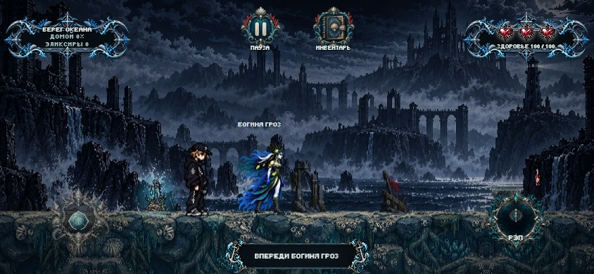
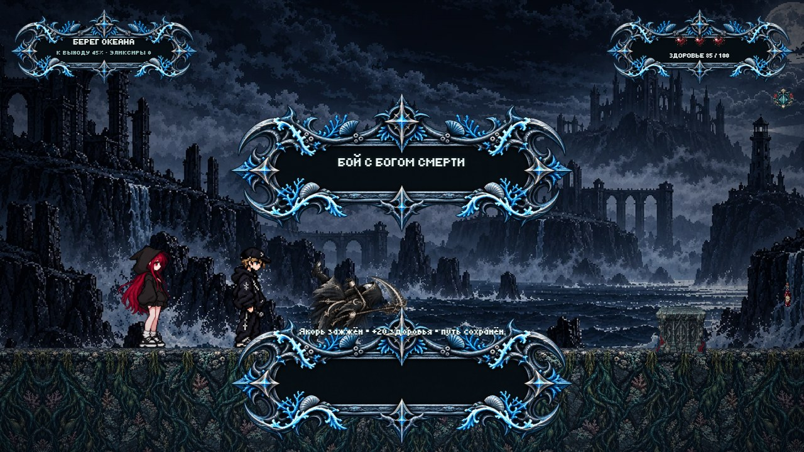
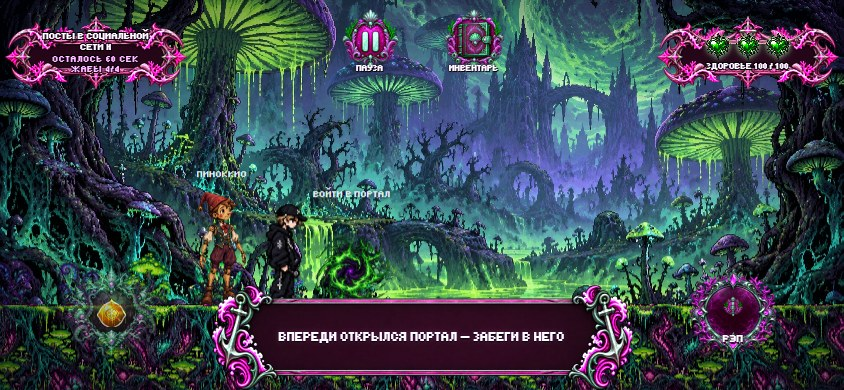
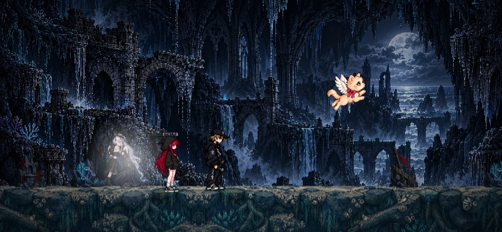

# Кусочек Океана… Порог сна 2

**Мрачно-морской платформер и отдельная вторая часть «Алисы в Шизолесье».** Андрей просыпается на берегу океана и узнаёт, что сам стал душой океана. Чтобы выбраться из сна, ему предстоит сохранить свою любовь.

[Играть в браузере](https://kusochek-okeana-porog-sna-2.vercel.app/) · [Первая часть — «Алиса в Шизолесье»](https://github.com/neonkitts/Alice-in-Schizoforest)

## Идея

Игра выросла из творчества исполнителя: его образы и настроение стали основой нового мира. Знакомые по первой части правила движения и боя получили мрачно-морское оформление, а история строится вокруг выбора, любви и попытки выйти из сна.

## История и механики

Встреча с **богиней гроз** открывает главную сюжетную линию. Она проходит через всю игру и приводит Андрея к двум другим божествам — **богу смерти** и **богине мечей** — и сражениям с ними. Финальная кат-сцена завершает историю богини гроз.

Игрок исследует берег, преодолевает препятствия, вступает в диалоги и бои. Отдельная механика переносит героя в **другое измерение**: облик мира, опасности и задачи меняются. В прохождении также используются погоня, предметы и встречи с персонажами.

## Как играть

Игра доступна **в браузере** на компьютере и телефоне: [открыть «Кусочек Океана… Порог сна 2»](https://kusochek-okeana-porog-sna-2.vercel.app/). На телефоне удобнее играть в горизонтальной ориентации.

## Состояние

Игра ещё находится в доработке. Скриншоты показывают текущую веб-версию; отдельной сборки для Windows нет.

